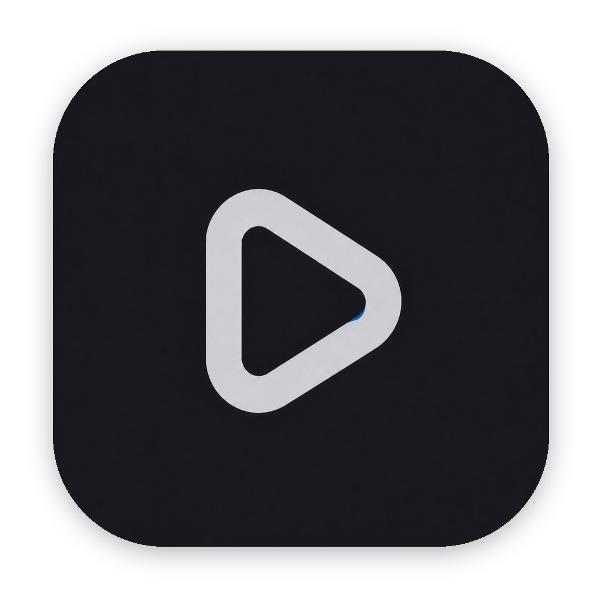
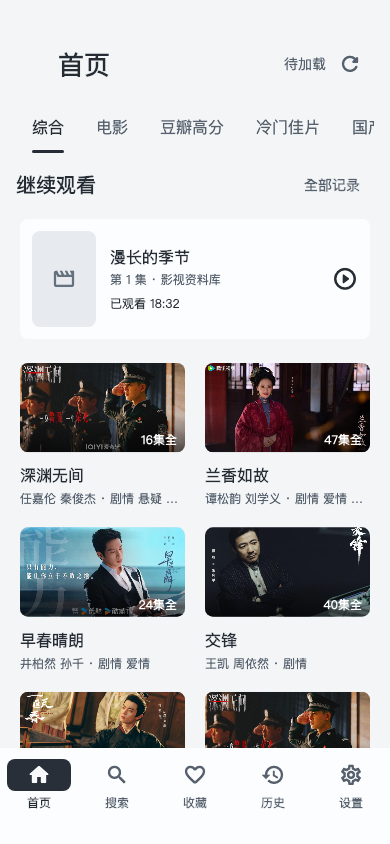
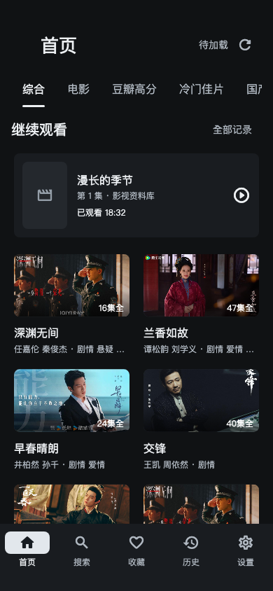
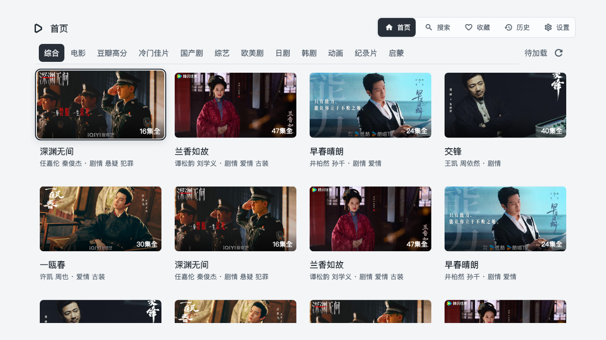
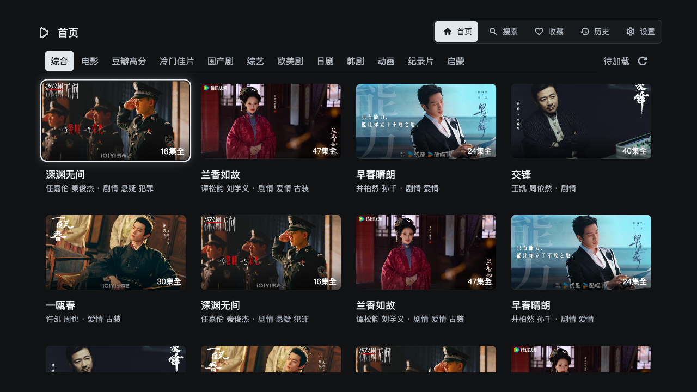
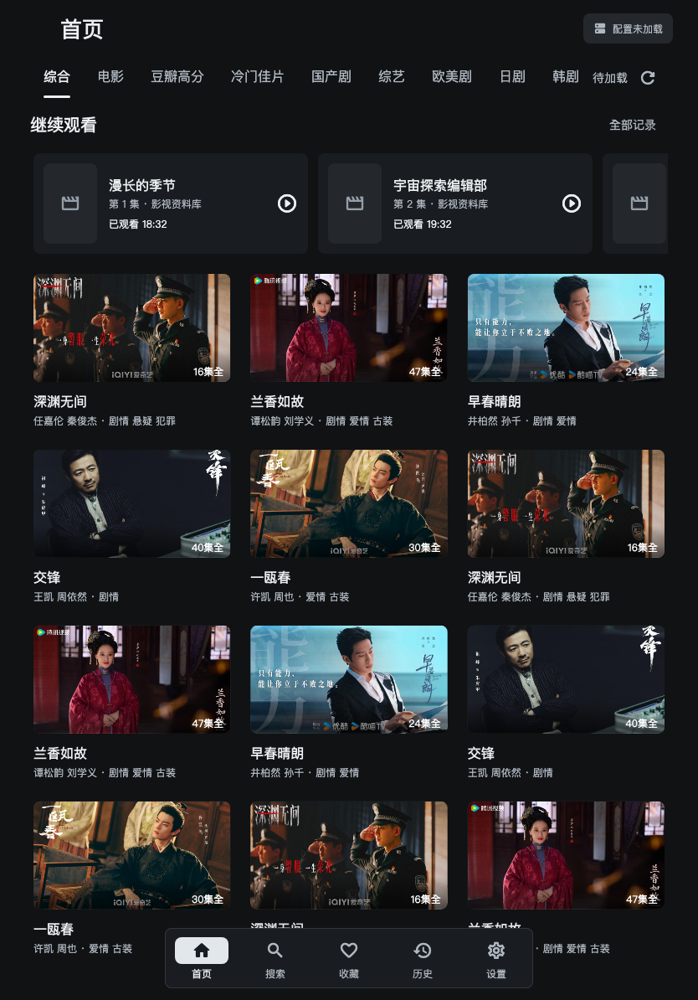
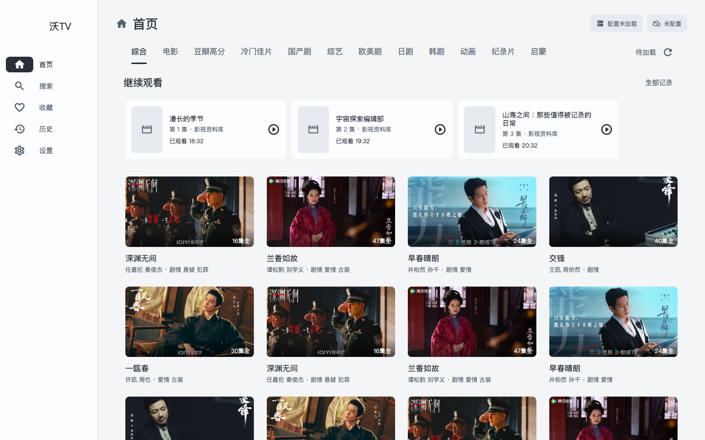
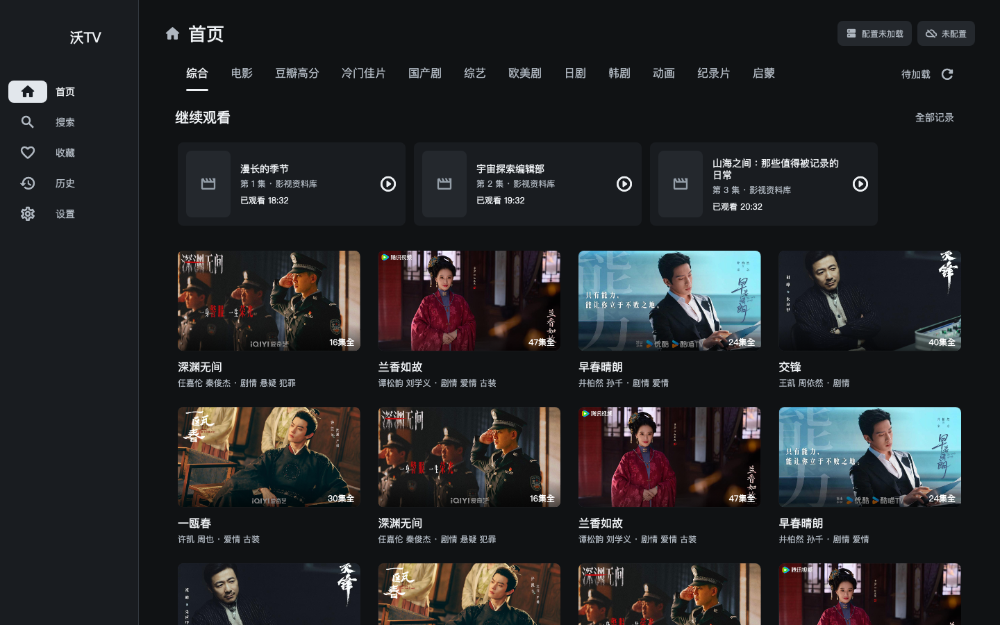
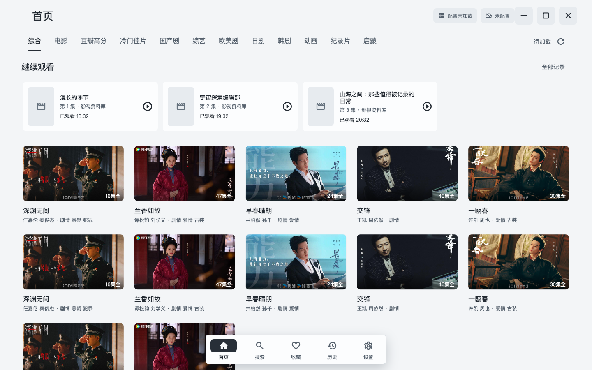
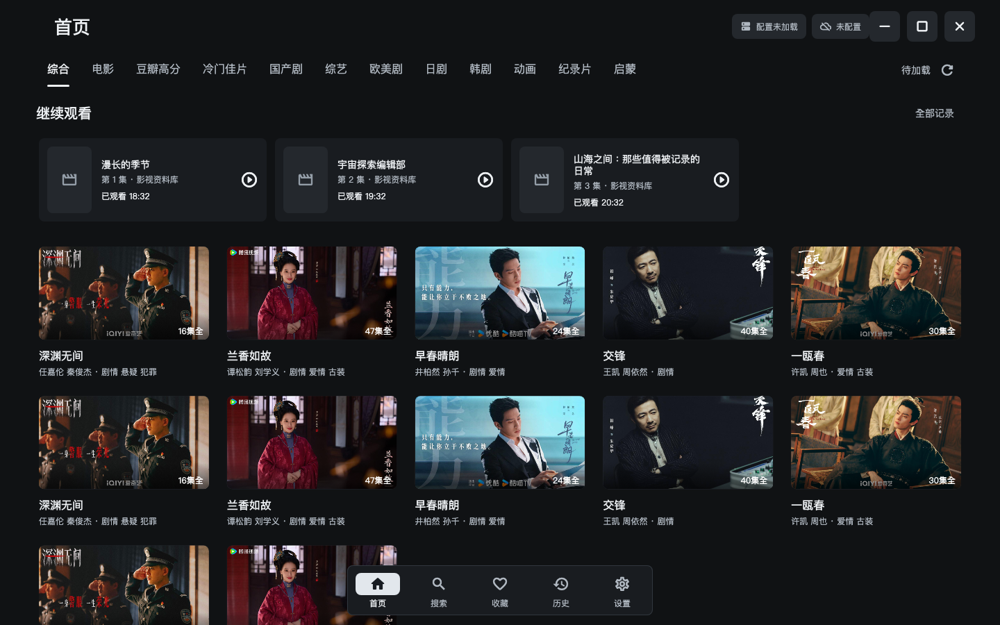

  

# 沃TV · WoTV

沃TV 是一款基于 Flutter 的跨平台影视客户端，支持 Android 手机和平板、Android TV、iPhone / iPad、macOS 和 Windows。提供跨源搜索、剧集选择、收藏与播放记录、夸克网盘播放，并针对触控、键鼠和电视遥控器适配界面。

本仓库提供沃TV的安装包、应用更新清单和界面预览。

## 下载

| 系统 | 安装包 | 下载入口 |
| --- | --- | --- |
| Android 手机 / 平板 / Android TV | 通用 APK | [最新版本](https://github.com/wuzhenghua-xijiang/wotv-releases/releases/latest) |
| macOS | 通用架构 DMG | [最新版本](https://github.com/wuzhenghua-xijiang/wotv-releases/releases/latest) |
| iOS / iPadOS | IPA | [历史版本](https://github.com/wuzhenghua-xijiang/wotv-releases/releases) |
| Windows | x64 ZIP | [历史版本](https://github.com/wuzhenghua-xijiang/wotv-releases/releases) |

当前最新发布提供 Android 和 macOS 安装包。iOS / iPadOS、Windows 请在历史版本中查找对应附件；iOS 安装范围由该版本的签名决定。

## 界面预览

以下为各平台布局的浅色、深色预览，使用示例内容；实际界面以安装版本为准。展开对应系统后，点击图片可查看原图。

<strong>Android 手机</strong>

| 浅色 | 深色 |
| --- | --- |
|  |  |

<strong>Android TV</strong>

| 浅色 · 遥控器焦点 | 深色 · 遥控器焦点 |
| --- | --- |
|  |  |

<strong>iOS / iPadOS</strong>

| iPhone · 浅色 | iPhone · 深色 |
| --- | --- |
|  |  |

| iPad · 浅色 | iPad · 深色 |
| --- | --- |
|  |  |

<strong>macOS</strong>

| 浅色 | 深色 |
| --- | --- |
|  |  |

<strong>Windows</strong>

| 浅色 | 深色 |
| --- | --- |
|  |  |

